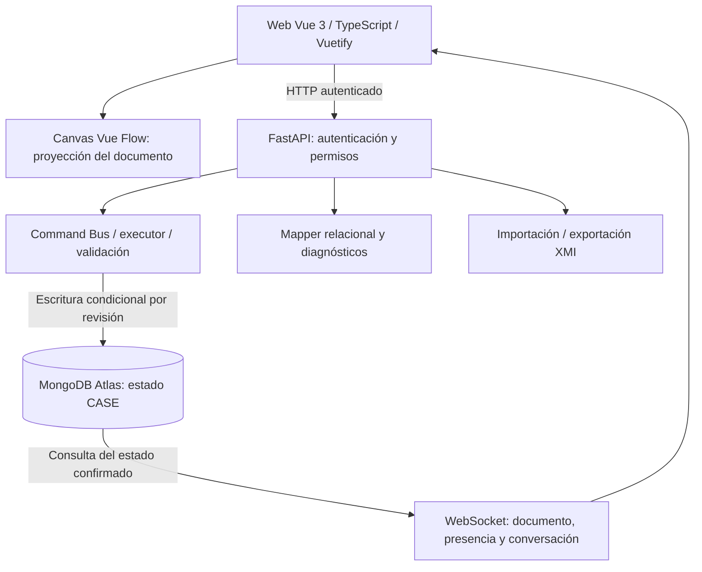

# Herramienta CASE colaborativa: base del informe

Fecha de corte: 7 de noviembre de 2026, America/La_Paz.

Este documento reúne material verificable para redactar la entrega académica. Describe un proyecto en desarrollo, no una aceptación final. El orden de implementación permanece en el [roadmap](../puds/use-cases/IMPLEMENTATION-ROADMAP.md); los requisitos y el stack permanecen en [product.md](../../product.md). Nombre definitivo, integrantes, materia, docente y formato institucional deben completarse al preparar la entrega.

## Problema y objetivo

El proyecto aborda el diseño compartido de diagramas UML de clases entre participantes que pueden encontrarse en lugares diferentes. Busca conservar un modelo consistente, controlar quién puede modificarlo y permitir retomar el trabajo con su contexto. El objetivo completo incorpora generación de aplicaciones e interacción con una IA grupal mediante solicitudes explícitas, además de consulta móvil y notificaciones.

Los requisitos del docente proceden de la transcripción aportada por el usuario. La [matriz del segundo parcial](../requirements/SECOND-PARTIAL.md) relaciona cada requisito con sus casos de uso y evidencia pendiente. Aún falta la rúbrica original del primer parcial para acreditar su cobertura completa.

## Alcance implementado y limitaciones

| Área | Implementación disponible | Límite de la afirmación |
| --- | --- | --- |
| Modelado | Clases, atributos, operaciones y relaciones; inspector, distribución visual y validación | No equivale a implementar todo UML 2.5.1 |
| Cambios | Comandos tipados, revisión optimista y deshacer/rehacer | Historial de deshacer/rehacer efímero por proceso |
| Acceso | Registro, inicio de sesión, propietario, editor, observador e invitaciones | Aceptación humana de todos los permisos todavía pendiente |
| Persistencia CASE | Adaptador MongoDB Atlas y migración conservadora del origen PostgreSQL | La demostración local actual usa almacenamiento ficticio temporal |
| Colaboración | WebSocket, recuperación de documento, presencia y conversación/actividad grupal | Falta aceptación conjunta de estas funciones en el entorno remoto real |
| XMI | Exportación e importación como nuevo proyecto del subconjunto soportado | Interoperabilidad con Enterprise Architect real pendiente |
| Modelo relacional | Transformación determinista y vista previa de tablas, claves y diagnósticos | No genera todavía una aplicación ejecutable ni ejecuta DDL |
| Generación de aplicaciones | CU-14 genera Spring Boot con CRUD, consultas, perfil de capacidades y navegación por FK simples; compilación y 51 comprobaciones PostgreSQL PASS | Descarga/UI pendientes; N:M/herencia/composición y reglas de runtime se rechazan. OpenAPI/Postman/Manifest y Flutter aún no generados como entregables |
| IA, voz e imagen | CU-18 prepara solicitudes grupales autorizadas y formulario, con contratos/contexto/resolver/Gemini y pruebas controladas | Falta clave, inferencia/benchmark reales y aceptación visual/cloud; voz, imagen y asesoría pendientes |
| Móvil y despliegue | Planificados en CU-23 y CU-28 | No hay visor móvil con push verificado ni despliegue integral aceptado |

## Actores y responsabilidades

El propietario administra su proyecto y sus colaboradores. El editor participa en el modelado y envía mensajes al grupo. El observador consulta el diagrama y el historial, con edición restringida por el servidor. La IA grupal es un actor previsto: su futura integración debe respetar permisos, mantener respuestas compartidas y actuar únicamente cuando se le solicite.

Los detalles y criterios de cada caso se documentan en los [CUs del proyecto](../puds/use-cases/IMPLEMENTATION-ROADMAP.md). Esta descripción no introduce casos nuevos ni reemplaza sus contratos.

## Arquitectura implementada

El backend de la herramienta es Python/FastAPI. Java/Spring Boot corresponde al backend que la herramienta deberá generar; no reemplaza al backend CASE. Vue es el cliente web principal. Flutter corresponde a otra salida generada; no acredita el visor móvil informativo solicitado por el docente.

El diagrama representa el funcionamiento normal. En el perfil de prueba local, MongoMock sustituye únicamente el almacenamiento con datos ficticios en memoria. Esa modalidad no prueba persistencia cloud. Véase [arquitectura técnica](../ARCHITECTURE.md).

## Modelo de información

`ProjectDocument` conserva identidad, propietario, revisión, metadatos, fechas, modelo UML y distribución visual. `CanonicalUmlModel` contiene la semántica; `DiagramLayout` conserva posiciones y medidas. El canvas proyecta esos datos y no constituye una segunda fuente de verdad.

| Colección normal | Responsabilidad |
| --- | --- |
| users | Identidad, correo normalizado y hash de contraseña |
| projects | Documento del proyecto, permisos y campos privados de coordinación/invitaciones |
| sessions | Participantes conocidos, mensajes y actividad del grupo |
| presence | Sesiones y señales efímeras con vencimiento |

Permisos, invitaciones, presencia y conversación no se insertan como clases o relaciones UML. La presencia no modifica la revisión semántica. El historial grupal tiene límites documentados y no se presenta como ilimitado.

## Flujo de una modificación colaborativa

1. El usuario autorizado solicita un cambio desde el editor.
2. El cliente envía un comando y la revisión base.
3. El backend comprueba identidad, permisos y validez del comando/modelo.
4. La persistencia acepta la escritura condicionada a la revisión vigente; un conflicto requiere recuperación del estado autoritativo.
5. Los clientes conectados reciben el estado confirmado mediante la sincronización; el frontend actualiza su proyección.

Este flujo evita presentar un cambio rechazado como si hubiera sido guardado. Los detalles de transporte y recuperación están en [CU-10](../puds/use-cases/CU-10-realtime-collaboration.md); el registro de actividad se describe en [CU-26](../puds/use-cases/CU-26-group-session.md).

## Transformaciones y generación

La exportación XMI y el modelo relacional derivan del modelo canónico. El modelo relacional actual produce tablas, columnas, claves, índices y diagnósticos según el perfil explícito de generación. No deduce reglas de negocio a partir del nombre de una clase o de un método.

Algunas multiplicidades requieren validaciones de ejecución que todavía no existen en un backend generado. CU-14 deberá resolver esas obligaciones o rechazar los planes no soportados; no basta con emitir claves foráneas. CU-14 ya genera Java 21/Spring Boot mediante Jinja2 y verificó compilación y ejecución con PostgreSQL. Soporta CRUD, consultas y referencias simples, y rechaza planes que requieren reglas aún no implementadas. El siguiente incremento incorpora entrega autorizada por proyecto/revisión y UI; después continúan los artefactos y el cliente generado según sus CUs.

## Pruebas y resultados disponibles

El último gate completo registrado el 7 de noviembre de 2026 aprobó **311 pruebas backend y 86 frontend**, además de análisis estático, comprobación de tipos y build. Son cifras históricas de esa ejecución, no una nueva ejecución en cada revisión del informe. Los detalles, avisos y correcciones están en [TESTING.md](../TESTING.md).

La migración CU-25 verificó 3 usuarios, 15 proyectos y 2 permisos, conservando el origen PostgreSQL. Trece proyectos legacy mantienen un propietario sin cuenta registrada; no se reasignaron automáticamente. Los CUs posteriores incluyen pruebas locales con MongoMock y comprobaciones HTTP/WebSocket; no equivalen a aceptar estos flujos en Atlas.

El usuario comunicó una impresión visual inicial favorable del proyecto el 7 de noviembre de 2026. No indicó qué escenarios completó: esa observación no cierra permisos, colaboración, importación o persistencia. El [registro de evidencias](EVIDENCIAS.md) separa lo comprobado de lo pendiente.

## Operación de la demostración

La [guía manual](../MANUAL-REVIEW.md) contiene los comandos de inicio/detención, cuentas ficticias y recorrido sugerido. En esta computadora la prueba usa http://localhost:5175, con API en el puerto 8001. Los cambios sobreviven a recargar la página mientras vive el servidor de prueba, pero se borran al reiniciarlo. No utilizar esa modalidad para demostrar recuperación persistente después de reiniciar ni acceso desde el celular.

## Pendientes para una entrega completa

La prioridad vigente del usuario es completar el segundo parcial: CU-18 → CU-19 → CU-27 → CU-23 → CU-28. CU-14 queda pendiente de reanudación con sus avances conservados; el roadmap mantiene las dependencias y la secuencia del resto. Posteriormente debe retomarse la IA grupal y voz, el despliegue y el visor móvil con push, además de los pendientes previos de imagen/interoperabilidad y aceptación integral. El [inventario de funciones antiguas](../requirements/LEGACY-GAPS.md) y el roadmap conservan el alcance y orden exactos.

Persisten tres aclaraciones registradas: rúbrica del primer parcial (RP-01), alcance de modificaciones por texto frente a solicitud por voz (RP-02) y alcance de NoSQL respecto de aplicaciones generadas (RP-03). No se inventan respuestas ni se cambia el stack para resolverlas.

Para la entrega final faltan evidencias manuales identificables, capturas de resultados reales, ejecución remota con permisos, recuperación persistente de conversación/actividad y verificaciones de los módulos todavía no implementados. No se presenta este informe como producto terminado.
